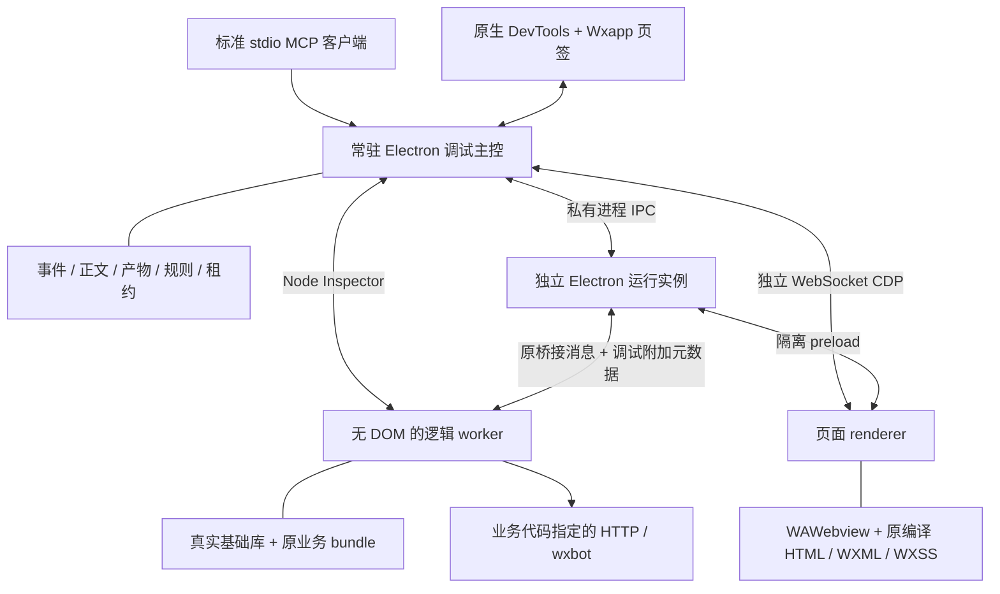

# WxappRunner 架构

JSON 调试预览：`json-preview.ts` 是前端与 MCP 共用的有预算解码器，只展开合法 JSON 中编码的对象／数组，报告路径及未完成原因。`devtools-media.js` 复用固定版本原生 JSONView 承载解析树和原始结构切换；不改 `Network.getResponseBody`、传输缓存或业务值。Wxapp 请求详情分组展示解析正文与原文。说明与验收（该内部记录未随源码发行）。

媒体调试正文：ViewNetwork 不再把空的 streamResourceContent 回执视为采集完整；必要时从 Chromium 保留的响应读取正文，部分流替换为完整缓存且不重新出站。CDP relay 使用 Chromium 解析后的 MIME 并兼容响应头大小写。`devtools-media.js` 在固定版本原 Network Preview 内增加 audio/video 内容视图，共用原 request content provider 和 ArtifactStore；无独立调试页面。验收与限制（该内部记录未随源码发行）。

实时遥测本地接收：`NativeRealtimeData` 保留真实基础库 9535 模块的调用及订阅，private RPC 将内容交给主控 EventStore / ArtifactStore；主控确认记录后回调 native，再单独派发 `onRealtimeDataResponse`。F12 和 MCP 读取相同缓存，大正文引用产物；回执明确标记 `local-only / uploaded:false`。不将此通道当作云数据库 watch，也不推测微信后台上传协议。契约、策略差异与验收（该内部记录未随源码发行）。

随机新包回归补充：包库保留根索引中的应用公共资源，共享文件按字节验证后去重。逻辑传输层将 Undici 8 的 HTTP/1 数组或 HTTP/2 头对象统一转给原生 Fetch 的旧 handler；由 Fetch 执行解压和重定向，raw/decoded 两套正文继续缓存。H2 头文本不冒充 HPACK 字节数；伪头查询凭证默认脱敏。新样本、证据与边界（该内部记录未随源码发行）。

页面预热：official PageManager 先分配独立 WebContentsView/CDP，并按实际窗口与页面 chrome 设置 bounds，再执行 WAWebview，等待 `page-preload-ready`。消费时发送一次 `bind-page`；视图在原 document 内更新配置，派发 onWxConfigReady 后执行页面文件，分别确认 loaded/readyed。预热不会发业务路由；失败销毁并释放导航队列，不自动重放。跨小程序热池仍未实现。 绑定与缩放使用原 __checkDeviceWidth__/onViewDidResize，当前页面通过已校验的 viewport 回执通知逻辑。detached tab 在重新挂载后重排并保留原实例；详见 视口回归（该内部记录未随源码发行）。

2026-09-12 最新接线：`loader/contexts.ts` 执行原 ContextManager 与 WeixinJSContext 工厂，VM 端口提供异步 loaded、配置、代码求值与销毁。主服务 ID 1 与业务上下文分开。`loader/workers.ts` 执行原 WeixinWorker/WMPFWorker 管理模块，`business-worker.ts` 在独立 Worker 中运行原 WAPCAdapterWorker/WAWorker；Inspector 就绪后才释放启动消息。`loader/pages.ts` 执行原 PageManager、AbstractNavigator、NormalNavigator 及队列模块，Electron 端口负责页面承载和布局，原库负责页面栈、tab 缓存、路由事件。失败恢复和迟到消息清理为显式宿主策略。原生 XWeb 帧与动画、全热池未宣称复刻；完整边界和证据（该内部记录未随源码发行）。

本次生命周期补强：关闭取消 VM ready/config 等待，失败预热项不能再次消费。Worker 启动前的消息在调用时克隆；接收端采用独立消息图适配，保留跨 realm 对象身份和共享 backing buffer，不再套用 wx API 对象包装器。原 EventEmitter 的 setOnError 接入统一日志。视图 native loadJsFiles 按原 PageFrame 的 eval(codes) 同栈求值；绝对 URL 与包路径共用执行缓存。编译插件确实合并在父入口时，以静态工厂、视图导出及模板注册建立路径映射；不以声明代替缺失代码或远端校验。实现与回归（该内部记录未随源码发行）。

首次页面程序也采用整批准备、连续执行：先读取官方 PackageManager 选择的文件，再执行 JS 与 HTML 内联脚本，保留跨文件全局词法绑定。此前逐文件 await 会让微任务观察到未完成的注册，现已通过失败前后对照修复。读取失败不执行新批次，执行失败不重放前缀；`view-program-stage` 在 F12/MCP 可查。官方证据与窗口回归（该内部记录未随源码发行）。

常驻主控同时拥有主逻辑、`worker:<id>`、`page:<id>`、`h5:<page>:<html>` 调试目标。Worker 的网络任务回调和销毁按 Worker 隔离；源文件仍为包内编译源码。F12 Wxapp 的“加载链路”与 MCP `runner_status.loader` 读取相同状态。宿主内部平台为 mac/windows/linux；公开设备模拟单独管理，legacy 保留原 android 内部路径。

2026-09-12 Socket 原生后端：每个 logic worker 的 NativeSocket 将原库任务 ID 和 native buffer 接到共用 socketApis；主包旧式全局监听与原生 SDK 连接实例隔离。消息产物/记录交给常驻主控，CDP 统一转换握手头并独立记录关闭回执。新连接执行 offline/local-only 预检，消息控制未自动套用 HTTP 规则。详情（该内部记录未随源码发行）。

2026-09-12 原生文件传输：新增每逻辑 worker 的 `NativeTransfers`，将原基础库 Upload/Download 任务 ID、状态和事件接到共享 `HostApis.nativeFiles` 与调试传输。下载原子提交并清理失败暂存文件；公共传输放行解析器空片段，避免暂停/恢复循环饿死取消与超时。证据、差异和边界（该内部记录未随源码发行）。

2026-09-12 原生网络：每个逻辑 worker 的 `NativeNetwork` 将原基础库 RequestTask 接入已有 fetch/调试传输；保留 SDK 的队列、序列化和回调，宿主只负责任务 ID、I/O、事件与 native buffer。主包 wx.request shim 保持原入口。任务 provenance 随异步上下文进入 F12/MCP；未知插件身份不推测。URL 检查标明 Runner 开放调试策略，仍保留原插件的 verifyPlugin 检查。官方差异与结果（该内部记录未随源码发行）。

2026-09-12 插件宿主对齐：logic worker 创建一份 `HostApis`，所有业务上下文、真实基础库 SDK 和插件 native invoke 共用持久化 storage／文件授权。主包 storage 调用也委托原库，保留其缓存和插件键名校验。`NativeFilesStorage` 只转换已确认的 native 参数、返回字段与二进制协议；同步返回和异步回调互斥。`wxConfig.env` 在基础库启动前提供虚拟路径，插件目录由原库推导。SDK 文件空间与普通用户文件权限分开；业务包只读。类型化 storage 兼容迁移旧文件并留存私有备份。契约和验收（该内部记录未随源码发行）。

## 方案选择

使用 **方案 A：微信真实基础库 3.17.3**。调用方已提供 91 个基础库文件，故无需方案 B 反编译再编译。包和基础库按原样只读装载，没有解密、改包或自制模板引擎。

本版本实际逻辑入口是 `WAServiceMainContext.js`，通过 native `WeixinJSContext` 创建 `WASubContext.js` 的业务上下文；`WAService.js` 单独不足以启动。视图使用 `WAWebview.js` 内真实 glass-easel / exparser。独立嵌套组件测试用腾讯开源模板编译器生成夹具，不改变业务包或生产渲染路线。

2026-09-11 经 IDA 和所提供 PC 适配器源码核对，默认复用 `WAPCAdapterAppIndex.js` 中原始 PackageManager 工厂，执行包准备与页面启动文件选择；AST 预检仍用于缺文件诊断，不再在官方路径主动执行推测的视图 chunk。文件读取、实际逻辑求值、包就绪事件由现有宿主实现，业务仍在无 DOM 的 worker。视图按 preload → onWxConfigReady → onInitialRenderingCacheReady → 原启动文件接线，loadJsFiles 等待有序求值后才成功，失败不重放。本轮进一步复用原始 AppServiceManager 的主上下文 preload/配置就绪顺序，独立分包直接冷启动与随后主包只执行一次已通过夹具。当时完整 AppIndex UI、ContextManager 和 XWeb/frame 后端未整体替换；最新 ContextManager/PageManager 接线见本文开头。旧路径可显式选 legacy。来源哈希、当前边界与验收见 官方加载链路（该内部记录未随源码发行）。

## 进程边界

定位在运行实例主进程的 `LocationService` 中选择 CoreLocation 或显式模拟坐标。F12/MCP 的 `runner_state(action:location)` 共用该服务，查询不需要逻辑 worker 继续执行，修改经过主控的实例写入队列。模拟默认关闭、仅当前运行实例有效，并保留小程序授权与原 JSAPI 回调；不修改业务包或系统位置权限。调试来源通过宿主事件记录，窗口标题与 Wxapp 面板明确显示模拟模式。

`main.ts` 保留原启动入口。普通启动加载 `supervisor-main.ts`，创建 `controller/service.ts` 和首个运行实例。子进程使用 `runtime-main.ts`，其中保留窗口、WebContentsView、页面栈和逻辑 worker。`WXAPP_STANDALONE` 仅供旧回归/兼容诊断使用，普通启动不使用此路径。

主控拥有调试窗口、回环鉴权接口、实例目录、Inspector/CDP 客户端、事件缓存、正文产物和任务。运行实例退出后主控仍可查询退出原因、旧请求与产物，并显式重启。逻辑暂停不阻塞主控状态、继续和等待取消命令。

业务 bundle 执行前先建立逻辑 Inspector；业务页面加载前先连接视图 CDP、Network 和 Fetch。实例启动状态与页面准备状态分别报告。导航、页面关闭和 ready 会即时推送状态，后台状态心跳用于补充观察。页面关闭会移除调试目标，拒绝旧目标调用。

## 装载与原生桥接

宿主区分包声明与实际后端：Skyline 声明页按 WebView 加载，在 `onAppRoute.renderer` 传 `webview`，保留业务包原配置。`getSkylineInfo(Sync)` 的 PC 常量仅报告能力，不参与内部选择。分离 bundle 补充宿主 `isLazyLoad`，本地异步分包接 native task 完成事件。详见 后端选择与分包（该内部记录未随源码发行）。

`loader.ts` / `loader/formats.ts` 静态读取配置、识别 page-frame HTML / JS 或 webview chunks，生成入口、逻辑文件、页面框架、依赖、错误的 `PackagePlan`。入口失败阻止启动；其他页面在导航改变栈之前完成预检。缺失分包明确报错，不用空页面顶替。

`page-frame.js` 格式直接执行原脚本，若同目录存在 `app-wxss.js` 则随后加载其中的编译 WXML/WXSS 注册；分包中的 `page-frame.js` 可独立包含模板。沿用现有视图脚本执行路径，不改写包文件或替换原生组件。

分包清单中的局部路径、完整根路径统一解析，组件依赖递归去重。存在原始分块入口时优先选择 `appservice.app.js`，只有合并入口时兼容 `app-service.js`。基础库请求的 `<chunk>.common.js` 仅在清单确认该 chunk 且独立文件不存在时映射到对应 `common.app.js`；未知依赖不跳过。`loader/scripts.ts` 维护每个业务上下文独立的已加载/失败缓存，避免重复注册和部分执行后的自动重放。

导航通过 `prepare-route → route-prepared` 屏障先完成分包逻辑入口装载，再将 onAppRoute 交给基础库，避免创建 not-found 实例后才注册页面。业务 RPC 和调试导航共用实例内队列，避免一个页面尚在初始化时被另一条导航关闭。加载计划仅依据包内元数据和文件，不包含 appid、业务接口或页面名称分支；下载与传输来源独立于运行时。实包与参数化验收见 加载器说明（该内部记录未随源码发行）。

`logic.ts` 在 worker 内创建基础库主上下文与业务上下文。业务无 window/document，模块加载交给 WASubContext。视图启用 contextIsolation、禁用 nodeIntegration，使用隔离 preload 的窄 IPC；不运行业务 bundle，不接收 wxbot 密钥。

基础库构造 WeixinJSBridge，宿主实现 `WeixinJSCore.invokeHandler/publishHandler`。原 publish 载荷经进程 IPC 和 preload 转发，保留目标 webviewId；订阅端接受解析后的对象。shadow-sync、组件数据绑定、生命周期、WXS 与 rpx/WXSS 主要由真实基础库执行。桌面原生 input/textarea 通过 native 键盘事件回到原业务 handler。

## 共用调试数据与协议

`controller/events.ts` 维护递增序号事件，携带 runtimeId、sessionId、time、source。页面、组件、请求和操作身份在可确认时补充。分页按游标向后扫描，过滤后也推进游标；淘汰报告 gap，跨会话调用拒绝复用旧游标。

`debug/context.ts` / `debug/state.ts` 使用 handler 包装、AsyncLocalStorage、回调包装及桥接旁路元数据，连接输入、原 handler、请求、回调、setData 和视图更新确认。业务事件对象不插入调试字段。未知来源保持未知，WebSocket 接收事件不武断归因于之前的 send。`runner_wait(kind:operation)` 只有调用方指定结果条件匹配时才报告业务完成，并注明该条件是调用方提供的关联依据。

`controller/artifacts.ts` 是文件缓存，正文多次读取不删除副本。默认限额由 `debug/limits.ts` 校验；原始传输编码字节、解压后的字节、文本字符集分别标识。截断、淘汰、失败与捕获中状态均保留；失败或截断的文件不能作为完整产物导出。进程退出时未观察到结束的请求标记 capture-error / completionUnknown，未完成产物标记错误。实例退出保留会话；显式 closeSession 或退出整个主控清理临时缓存。

`controller/cdp-relay.ts` 为原生 Network 提供共享记录、历史事件和可重复读取正文；其他命令交给真实 Inspector/CDP。每个原生前端、后台观察者是独立连接，不使用会被人工 DevTools 抢占的 `webContents.debugger.attach`。原生对象、调用帧及断点 ID 带连接身份，避免与 MCP 的 Inspector ID 混用。旧前端不能控制重启后的新会话。

## 原生 DevTools 适配

`devtools-contract.ts` 集中固定 Electron 40.10.6 / Chromium 144.0.7559.236 入口与模块路径。逻辑用 bundled `js_app.html`，视图用 `inspector.html`。`wxapp-panel.ts` 注册原生 ViewManager 页签，`devtools-preload.ts` 仅向主控暴露鉴权后的工具调用；不使用单独网站。

Chromium 远程入口没有本地 Workspace 文件系统宿主，却仍会构建该工具栏。本适配为缺失的文件夹绑定动作注册明确禁用的项目，避免 Sources 揭示源码时抛错；不伪装文件系统绑定可用。包内脚本和已有 source map 由下述只读读取器提供。

Node/V8 业务 vm 上下文的 `auxData.isDefault=false` 会被 Chromium 前端误当成浏览器扩展脚本，从而自动忽略断点/source map。只在本适配的原生逻辑前端连接中，针对已命名的业务上下文去掉此浏览器标记；保留真实脚本、位置和映射。MCP Inspector 元数据不改。原生断点由 MCP 删除时，通过前端 BreakpointManager 移除，确保 Sources UI 与后端一致。

业务包已有 source map 由限定包/基础库/运行时根目录的读取器提供；没有 map 显示实际编译文件。CPU、heap 和 allocation sampling 使用真实 Inspector Profiler/HeapProfiler；视图 trace 使用 Tracing/IO。分析任务启动、查询、停止分离；大 heap chunk 与 trace IO 流写入产物。目标不支持、断线、任务冲突、预算不足明确失败。

逻辑顶层求值先调度到 worker 的正常事件循环，再由仅负责 Runtime 求值的本地 Inspector Session 执行。暂停/恢复仍使用主控的外部 WebSocket Session；不存在由同线程监听器恢复自己的断点。结果通过临时对象盒交回原连接，保留 Promise 身份、远程对象、原生 REPL 顶层 await/重复声明和异常。这样避免 Runtime.evaluate 在基础库函数尚未建立完整作用域时作为 V8 中断插入，触发 ScopeIterator::NeedsContext 检查崩溃。该位置使用与 Electron 40.10.6 UUID 匹配的官方调试符号确认；回归包含 4 次独立启动、20 次条件断点、超过 5 秒的人工暂停和原生 REPL 语义。命令超时由主控管理，不终止或重放业务表达式。

## 网络控制

`wx-shim/network-context.ts` 在小程序 request/upload/download 入口补齐官方宿主的 `https://servicewechat.com/<appid>/<appVersion>/page-frame.html` Referer；业务传入的 Referer/Referrer 不覆盖宿主身份，宿主 wxbot/包下载不受影响。`loader/package-version.ts` 使用显式版本、同 appid 下载 manifest 或包配置，未知版本明确报告并按原生规则使用 0。参考 IDA 与真实包验证（该内部记录未随源码发行）。

独立调试运行时不强制执行微信平台的 `<web-view>` 业务域名登记/认证白名单，后续内嵌网页宿主按此约定实现；这不表示 `<web-view>` 已完成接入或验收。网页隔离、URL 协议校验和 TLS 证书校验仍由宿主正常执行。业务域名策略与小程序页面的 `webview` / `skyline` 渲染器选择相互独立，放宽域名策略不能代替渲染器支持；不通过改写业务包的 renderer 来伪装兼容。

`debug/transport.ts` 通过 Undici dispatcher 统一逻辑 wx.request、wxbot、上传和下载的 HTTP(S)，在真实传输中实施离线、延迟、上传/下载节流，并观察跳转、原始字节和解码字节。业务回调保持 HTTP 非 2xx 走 success、网络错误走 fail、complete 一次的语义。流式上传/下载保留任务取消和进度，SocketTask 提供真实帧及事件监听。

`controller/view-network.ts` 以 Chromium Network 采集资源，Fetch 域执行请求修改、阻断、Mock 和暂停；Chromium 自身限速与缓存控制用于视图目标。浏览器不提供原始压缩字节时标记 unknown/unavailable，不从解码正文反推传输细节。

`controller/rules.ts` 的规则默认禁用，按 priority 降序、创建顺序升序；modify 继续，block/mock 终止。请求记录保留命中和改前/改后信息。挂起请求有 owner，客户端断线释放并禁用该客户端暂停规则，60 秒保护性释放有事件。显式 replay 创建新请求并关联 replayOf，不重放原 handler；正文缺失/截断时要求替代正文，不自动重发。

无需 MITM、系统证书或系统代理，范围是运行时自身的 HTTP(S)。WebSocket 记录帧；HTTP 规则不是 WebSocket 帧改写器。没有实现微信完整 cookie/cache/HTTP2/QUIC 等网络栈语义。

## 状态、自动化与协作

组件适配分别处理真实 glass-easel / exparser。通过实际 selectOwnerComponent、实例限定查询和 DOM 的框架 owner 链确定父子关系；动态销毁后标记失效，不靠位置或文字猜测。状态修改调用原实例 setData；storage 修改走 wx API。DOM 支持属性、value、样式、布局、组件映射、高亮及截图；滚动容器截图会恢复原滚动位置。

元素快照按 MCP 客户端保存，绑定页面身份与版本；新快照只使本客户端上一快照失效。点击/输入检查互斥定位、坐标、遮挡、可编辑和稳定状态，不把鼠标送达当成业务成功。等待支持结果条件、操作前网络游标、取消及关闭页面错误。modal、action sheet、文件请求由同一个 DialogController 处理，人工和 MCP 竞争时只完成一次回调；文件沿用现有只读授权。

定位沿现有 worker RPC 接入 `LocationService`，逻辑层没有 DOM。服务持有按 appid/profile 落盘的小程序权限，复用 DialogController 处理授权和设置窗口；macOS 独立签名辅助 app 使用 CoreLocation，经有界 JSON 管道返回真实 WGS84 观测值，宿主按请求转换为 GCJ02。系统权限由 macOS 管理，调试接口不能将其覆盖为允许。页面身份和操作上下文随桥接附加信息传递，页面关闭/撤权会终止请求并拒绝迟到结果。原生位置成功分支、微信精确授权时序和其他平台边界见 定位验收（该内部记录未随源码发行）。

写入按实例串行；状态查询和调试恢复独立。控制租约默认 60 秒，支持续租和释放。真实人工页面输入、原生 F12 输入、Wxapp 修改优先，撤销 AI 租约并拒绝尚未执行的旧批次修改。观察连接断开自动重连，不重放业务操作；崩溃只记录并等待显式重启。

storage、wxbot 配置和 Chromium 数据按 appid/profile 隔离。跨主控 PID 所有权文件保证正常启动时同一 app profile 只有一个写入实例；额外未指定 profile 的实例使用隔离目录。换包先预检并取得目标 profile，再停止原实例。主控自身 Chromium 临时目录按进程独立。

## 参考与验收

- [Electron debugger 连接行为](https://www.electronjs.org/docs/latest/api/debugger)
- [CDP Fetch](https://chromedevtools.github.io/devtools-protocol/tot/Fetch/)
- [腾讯 glass-easel](https://github.com/wechat-miniprogram/glass-easel)
- [DevTools DebuggerModel](https://github.com/ChromeDevTools/devtools-frontend/blob/main/front_end/core/sdk/DebuggerModel.ts)

结果和限制以 覆盖矩阵（该内部记录未随源码发行） 与实际 JSON 验收记录为准。macOS 为本轮平台；完整原包的 28 个分包页面已补齐并完成加载验收。既有不完整目录保留为错误夹具；Windows/Linux 与完整真实业务流程单独待验收。生产下载文件交付不与加载器耦合。

## 356 页覆盖增量

`src/suite/catalog.ts` 从明文编译模块 AST 与 loader 的组件依赖闭包建立页面清单。原始包是事实来源，可选参考 WXML 仅补充控件信息。预检、页面可见、流程断言和真机效果分别记录。`src/suite/jobs.ts` 在主控执行后台任务；每一步仍走原工具的校验、实例队列和人工接管机制。取消不撤销或重发业务操作。

后续基础库可能创建广告/XR 等辅助上下文。`logic.ts` 的 businessContexts 仅登记装好真实业务基础库的上下文；分包注册只注入该集合，不向后来分配的辅助上下文盲目执行 common.app.js，避免缺少 __wxCodeSpace__ 后破坏所有后续导航。

`DeviceRuntime` 位于业务 worker，拥有模拟设备状态和原 wx 监听器。设备预设与硬件输入显式启用；只更改业务可见信息，不改变 official 的内部 PC 桥接能力选择（legacy 仍为 Android 对照）。系统定位与账号权限独立。`capabilities.ts` 记录 API 来源，实际流程验收另查矩阵。

正常 video native 路径由 `native-components/video.ts` 在原 wx-video 的真实 DOM 容器创建 Chromium HTMLVideoElement，原业务仍由基础库执行。根据真实组件 getContextId 定位，不按坐标猜组件。容器就绪异步回调避免订阅竞态；视频事件使用 WAWebview 的 videoPlayerId、position 等字段，ended 按其适配器要求提供序列化 data.viewId。3.17.3 normal-native 分支只处理发布的 play，其余 VideoContext 消息由桥接补上；未知组件不报空成功。`http-file.ts` 提供流式本地媒体和 Range，避免 seek 退回 0；宿主 /page/:id 路由不再吞掉包内 page/component/resources 路径。

`CloudRuntime` 调用原始 wx.cloud SDK，native operateWXData 将原请求 JSON 序列化后发到配置的 wxbot，校验 HTTP、ok/ret、外层业务结果，保留原 json 字符串给基础库继续解析。原 SDK负责数据库/云函数/云文件的具体协议。MCP 云任务返回 ID，读写结果和 SDK 完成状态不等同于原页面业务验收。直连 cloudfunction 是没有原 SDK 时的备用能力，实测服务要求显式 env（提供的 OpenAPI 未列），不能推测环境。当前仅执行真实只读验收，远端授权确认及写入未冒充通过。

本次仍有未完成的原生/硬件/专项后端，不把旧 P0–P6 调试报告用作新范围的完成证明。详见 全覆盖进度（该内部记录未随源码发行）。

## 宿主数据和页面导航边界（2026-09-11）

`loader/navigation.ts` 保留公共导航 URL 中的业务编码层，不把 query 当作表单调用 `URLSearchParams` 解码。3.17.3 的 `onAppRoute` 对非启动页解码一次，宿主在此边界提供对应的传输编码；首次启动视图另行处理，返回时也保留启动页身份。基础库自己发起的 native 导航单独标记已编码来源。公共 API、MCP 和宿主栏共用导航队列，业务相对路径按当前页面目录解析，配置中的 tab 路径按包根解析。

隐私查询/监听/授权继续由真实基础库负责，原同意按钮通过既有视图→逻辑通道登记实际点击并上报。`getPrivacySetting` 的服务端元数据经 `operateWXData` 读取，不用本地常量假定已同意；用户账号隐私授权和宿主硬件/模拟定位权限仍是不同状态。

`wx-shim/realm.ts` 将宿主 API 返回值和回调数据转换到业务 VM 的 Array/Object/ArrayBuffer 等类型，保留任务方法、事件监听与取消时的函数身份。原基础库 API 直接委托；业务数据不经过调试预览截断。网络回调携带 Node 数组会导致基础库中的 realm 类型检查失败，表现为 Page.data 有记录而 WXML 仍为空。

`shell-layout.ts` 根据原包 `tabBar.custom` 与逐页/全局 `navigationStyle` 决定宿主导航和视图边界：自定义导航完全由原组件显示，不重复绘制或预留宿主空白。定位调试位置默认会话有效，显式保存时按 appid/profile 写入独立文件，在首个业务生命周期之前恢复。

## Map、Cover 和 Camera native 后端

`view-native.ts` 按原生 API 名称分派至独立后端，组件实例以真实基础库 ID 匹配。Map 使用 Leaflet；TextView/ImageView/ScrollView 使用基础库生成的原 DOM，解除原生绘制隐藏门控，保留业务层样式和事件。Camera 只负责媒体输入与渲染，将帧经 IPC 写入逻辑 VM 的 native buffer，再发送原 onCameraFrame/onCameraScanCode 事件，业务仍在 worker。cameraId 与 pageId 共同定位缓冲区，不能假定来自首个页面。权限由同一宿主服务保存；真实基础库经 bot 查询授权时，本机硬件 scope 覆盖远端同名值，不隐式授权。详见 实现边界（该内部记录未随源码发行）。

## 通用包获取服务

`src/packages/` 在业务实例和调试主控之外运行本地包服务。MCP 的 `runner_packages` 直接经同一 broker 访问服务，因此旧主控保持运行时也能使用新能力；新版主控中的原生 Wxapp 面板委托给相同 broker，CLI 同样复用。服务仅监听回环地址并要求本地随机令牌，不把 bot 密钥或签名 CDN URL 交给面板或工具结果。下载任务独立于 MCP 客户端寿命，异常退出记录 interrupted，恢复后不自动重放。

搜索和解析遵循现有 wxbot 契约：`/mp/wxa/search` 取得候选；`/v1/miniprogram/downloadpackage` 使用 `urls_only:"1"` 解析 appid/version。主包先取，解析其 subPackages/subpackages，再使用相同版本并行取分包。传输层只在 bot POST 携带鉴权头，CDN GET 不携带，重定向也不转发密钥。字节以 zstd magic 判断是否解压，随后直接解析 0xBE...0xED 的 wxapkg 索引；不包含任何 V1MMWX/AES/PBKDF2 解密。

解包校验路径、边界、冲突和大小，允许真实包出现的完全相同重复索引。模块在隔离暂存目录合并，所有声明分包成功后才原子发布版本目录，manifest 保存逐文件哈希。loader 仍然只接收明文目录，业务包文件不改写；加载前复用原有预检，下载完成与业务运行成功分别报告。包库与工作实例的数据目录无关，搜索下载不会修改当前页面、storage、定位或账号。详见 [包服务文档](docs/packages.md)。

## 受控函数与模块分析

`src/analysis/` 为 MCP 与原生 Wxapp 面板共用分析实现。新版主控从同一请求缓存执行查询；stdio 通过版本响应头识别旧主控，使用其既有状态/evaluate/debugger/network 接口完成兼容，不重启现有运行实例。过滤输出不消耗正文缓存；列表省略大头和调用栈，详情提供解析预览与原 artifact 引用。

Hook 的 VM 端管理器保留目标属性描述符和有界环形缓存，以函数 Proxy 转发调用，按次数、同步抛错和有效期恢复；记录按进入顺序编号。恢复时不覆盖业务已替换的新函数。只读条件通过受限 AST 解释，不执行任意条件代码或普通访问器；Promise 返回身份保持原样，不附加观察用 then/catch。它是受控属性拦截，不能当作任意 evaluate 的回滚沙箱。

模块源码来自本地逻辑 bundle 的 define 工厂 AST 边界，保留真实行列和文件位置。运行时符号通过 V8 FunctionLocation 映射，不按 toString 猜测。基础库 3.17.3 的 require 闭包缓存由 Inspector 只读查询 factory/status/exports，用于确认模块已加载；无法确认时默认拒绝为 hook 隐式初始化模块。扫描与定位不能还原不存在的源码或共享解释器中的原函数。详见 [分析工具](docs/analysis-tools.md)。

## 可选启动分析

`analysis.enabled` 在 `WASubContext` 和 wx realm 接线之后、所有 `PackageScripts` 业务文件之前安装 `bootAnalysisRuntime`。主控预检 bootScript 语法再改变实例状态；分析 profile 默认独立。VM 内保存不可变工具入口、原始描述符与限量环形记录，结束/TTL 恢复仍属于工具的 patch，已保存的 wrapper 别名转为直通。普通对象不受 `defeatAntiHook` 放宽；未开启时不装这些 patch。

AsyncLocalStorage 将观测 run/call ID 传给既有 debugContext，网络与事件流保留可确认关联。原像留在业务 realm 限量缓存，通用事件流只传元数据。新版主控声明分析协议版本 3；旧主控仍可由 stdio 提供 live 适配，Boot 参数明确拒绝，避免伪装成前置注入。F12 与 MCP 共用 AnalysisTools。能力明确报告 opcodeTrace:false，不改写磁盘业务源码、不推断未捕获的指令。详见 docs/boot-analysis.md 和下节的内存执行插桩。

## 内存执行插桩与 Autopsy（分析协议版本 3）

`analysis/execution/instrument.ts` 使用固定版本 Babel 解析器、遍历器和生成器。主控在替换实例前预检选定脚本及模块；worker 在基础库之后、PackageScripts 执行前安装执行记录器，只在内存中转换选定业务文件。后续分包沿用同一路径。位置表与 inline source map 指向原始文件，API/frame 身份包含文件和内容哈希，避免跨文件绑定冲突。

原生 JS 操作完成实际运算、属性键转换与副作用；旁路维护有界帧、变量绑定、对象/属性和调用身份。Proxy 不额外枚举，无法确认的 getter/setter、native、spread 和动态执行依赖明确标记未知。AsyncLocalStorage 将 executionRunId/executionEventId 传到原 debugContext，HTTP 记录据此关联真实调用和参数对象。默认切片区分数据值依赖与对象/索引地址依赖。

`AutopsyJobs` 位于常驻主控：验证目标与原操作、保存请求游标、只增加本任务所需的 tap、最多调用一次显式 trigger，随后按运行/操作身份选定请求。没有 trigger 时等待人工输入。报告将 request option 的字段 ref 交给反向切片，并导出实际捕获函数及 receiver 的会话句柄。取消、断线、超时不重试业务，清理只停止自身采集；完整恢复通过重建隔离实例实现。

F12/MCP 共用 AnalysisTools 与 ArtifactStore。执行大结果内联限制 128 KiB，脱敏报告可分块读取；原源码与显式原值产物保留访问要求。Wxapp 的只读控件不产生虚假的人工接管，其修改仍经类型化队列；其它原生 DevTools 表面保留人工优先。静态候选与运行调用分开表示，Oracle 不序列化闭包，不承诺一次执行就是完整 Chaos 算法。

最新教程及真实样本边界见 [执行分析](docs/execution-analysis.md) 和 验收矩阵（该内部记录未随源码发行）。

### 内嵌插件与接口命名空间

2026-09-12 随机包补充：私有模板插件不要求公开组件导出才映射其合并 pageframe；仍须 AST 证明同作用域的工厂和模板。业务 `plugin://` 页面导航委托原基础库解析公开别名，再进入已有 native 导航队列，不把协议 authority 当作可丢弃的 URL host。

旧 CanvasContext 依赖的主服务 `NativeGlobal.OffscreenCanvas` 使用 `@napi-rs/canvas@1.0.9` 提供实际 2D 字体测量，无 DOM。业务绘制仍由原基础库发布给视图 canvas。该端口有尺寸/像素预算，不等于开放完整 OffscreenCanvas/WebGL API。调试 setData 包装保留非函数参数语义，遇只读属性记录无法观察，生命周期和清理不因此抛错。详见 两批新包回归（该内部记录未随源码发行）。

`loader/plugins.ts` 只静态读取所选主包/分包逻辑入口中的 `definePlugin`、字面量组件配置和 `publishDomainComponents`。保留 `plugin://` 与 `plugin-private://` 协议，不用文件路径规范化压掉双斜杠；根据声明作用域、公开映射及真实工厂解析依赖。插件内部相对路径留在其代码空间，不能继承宿主的全局组件。缺失的工厂或导出仍报错；有有效占位时单列 `PagePlan.deferredComponents`，占位自己的资源也须通过校验。静态发现不等于工厂已执行或所有 native API 可用。

插件工厂、模块缓存、组件注册及生命周期继续由真实基础库执行。当前扫描范围是内嵌入口工厂；单独分发的插件包、动态工厂和远端验证需要后续独立契约，不能用成功桩替代。`wx` shim 的枚举表与读取表保持一致，保证 `for..in`/`Object.assign` 后仍能调用原始 SDK 函数及其真实返回/事件语义；未知操作在 native 边界失败，枚举存在不改变 `canIUse` 和能力注册表的支持结论。

网络调度固定使用 Undici 8.10.0，适配其 controller 回调与 Node/Electron Fetch 的旧 handler 协议。保留 Fetch 的重定向和解压处理，传递原始头、暂停/恢复和取消，不删除断言或吞掉进程错误。连接关闭期间的慢正文采集用独立子进程回归，验证完整正文、截断错误和限速。见 实施记录（该内部记录未随源码发行）。

### 带插件基础库的 Boot 属性预留

`analysis/intrinsics.ts` 在业务 VM 创建后、WASubContext 执行前，仅在 `analysis.enabled && defeatAntiHook` 下临时保留白名单内置数据属性与模块加载全局。原因是基础库的插件安全分支会先把它们改成不可配置访问器，后置 tap 已无法安装。预留不执行业务探针或用户脚本；真实基础库初始化结束后恢复临时拦截器，再沿原 Boot 时序装 tap。原始基础库/业务文件不改写，普通模式不预留。影响数量和清单可从 `status.preparation` 查看；完全恢复使用新普通 realm。

逻辑启动异常携带结构化 error/diagnostic 到实例主进程，主控据 `logicFailure` 进入 failed 状态并保留 Inspector。failed 实例仍持有 profile 锁，并参与停止/重启/退出清理；错误不会遗留永久 starting 状态。见 修复验收（该内部记录未随源码发行）。

## 调试复盘修复（协议 4）

这些接口最低要求 X-Wxapp-Analysis: 4。新 stdio 在发送 scoped taps、arm/disarm、精确工厂或 local-only 参数前检查版本，避免旧主控静默丢参数。Boot 观察器保存实际执行工厂及模块 cache owner，source/hook/oracle 共用；静态 factoryId 由 file/start/hash 组成。生成代码的 V8 位置先经匹配原文件的 inline source map 还原。

方法引用在参数执行前保存 receiver 来源，call/apply 保留显式 thisArg；输入引用与证明返回值的数据依赖分别标记。Autopsy 通过服务的 artifact 接口读取完整执行图，Crypto 按 run 分页，并汇总所有已知缺口；任务 complete 不代表 HTTP 或业务成功。状态查询附独立的最新 transport outcome，artifact 保留生成时快照。

限定 scope 的 Boot wrapper 可以保持安装而暂停计数，显式 arm 绑定 executionRunId/operationId；过期恢复后不假装能重新替换已有别名。local-only 是配置化的运行时 HTTP(S) 实验策略，由逻辑传输和视图 Fetch 共用规则引擎，在最终 URL 及每一跳重定向检查，只允许字面 loopback IP。默认 normal，支付与系统级网络隔离不在这里实现。

## 可读分析与业务条件（协议 5）

当前主控返回 X-Wxapp-Analysis: 5，新增选项按各自最低版本协商，协议 4 的合法调用不被强制升级。`crypto-evidence.ts` 在主控／分析服务中以 Node Crypto 对捕获的完整字节作独立验算。Boot 只收集真实参数、结果与配置描述符／引用；不额外调用 getter，不在业务 worker 中重跑算法。模式、填充和编码未知时保留不可验算原因；数值一致不建立因果边。Crypto 摘要与 Autopsy 报告复用此模块。

Autopsy `resultCondition` 验证后交给原 `runner_wait`，在显式触发前开始观察；日志保存操作前游标。结果等待与字段证据、HTTP 状态独立，取消信号只清理该任务的等待和采集。已采集报告在结果超时／取消后仍保存为 artifact；没有请求时不生成虚假字段证据。只读 preflight 不申请修改通道或触发人工接管，查看实例、插桩、请求与 Oracle 可用性。

F12 表单调用同一服务。预检结果绑定配置与会话，改参数后启动按钮失效；一次启动后按钮关闭，不能误点重复触发。源码跳转依据真实行列与工厂范围唯一定位；A/B 保存会话身份、同时对比执行、Crypto、网络。后台列表刷新按结果版本检查，不覆盖后续显式操作输出。

## 2026-09-12 加载与调试增量

`HtmlWebviews` 在实例主进程创建独立 WebContentsView，按 pageId/htmlId 绑定，页面隐藏/恢复/销毁同步到 H5，首次导航前建立 CDP 观察连接。每个 H5 是 `h5:<pageId>:<htmlId>` 调试目标，继承服务的网络记录与规则。Node 禁用、sandbox 与 contextIsolation 开启，preload 只提供 WeixinJSBridge 和环境标记；网页自行加载 wx SDK，宿主不注入局部 wx，防止跨平台库误选小程序环境。重复 src 的几何更新不重启重定向后的网页。

宿主用于连接观察器的初始 `about:blank` 不属于业务历史。`H5History` 在文档提交时仅移除该初始化条目，保留网页自身的跳转、pushState 和锚点；可返回步数为零时退出小程序页面。同文档导航同步真实 URL，空白文档单独标记。official 和 legacy 共用这一历史边界。返回空白页修复与验收（该内部记录未随源码发行）。

视图图片等资源通过已有 Fetch 管线只改写浏览器实际发送的本实例 Referer；不新增 no-referrer，不改 H5 或外部网页来源。Fetch/Network 回执可乱序，按 networkId 和 URL 保存待配对的元数据；原始 extraInfo 与 Fetch 明确覆盖值分别保留。分析 local-only 仍阻断外网，在标题及请求摘要明确显示原因。

Inspector 对页面求值按主 frame 选择默认 world，使用唯一上下文身份，导航期间失效报告 CONTEXT_CHANGED，不自动重发表达式。`getRendererUserAgent` 读取所属视图真实 UA，经业务 realm 转换后保持 Promise<string>/success({userAgent}) 契约。

初始化执行采集与 invocation 分别保留，通过确切引用相连，共享可配置字节预算。局部 dependencies 区分 data/address/control；仅已插桩的 if/条件表达式/逻辑表达式具备控制依赖，循环和 switch 分派未承诺完整覆盖。闭包持有的调用帧有界保留，超限报告缺口。停止 run 后的 export 在主控分页流式写产物，不把大结果堆进 MCP 正文。

分析 suite 的 saveAs/bind 只解析白名单标量 ID，禁用原型路径；mode:analysis 保留页面、最多显式调用一次。取消发生在 capture-start 回执期间仍先登记所有权再清理，不触碰用户原采集。详见 验收与边界（该内部记录未随源码发行）。

## 2026-09-12 PC 页面 UI、2D Canvas 与插件校验

`OfficialPageUi` 复用原 PC navbar/share 模块工厂，宿主仅提供 page/navbar/menu 端口。异步上下文绑定原页面，页面关闭后不把迟到更新施加到新的 currentPage。Shell 读取同一状态，MCP 的 current/stack.pageUi 与 pageUiModules 可查结果及模块来源。装饰器日志经有界 clone 后才进入主控 IPC，避免 VM Promise 导致克隆失败。

原基础库 node Canvas 的 save/get/remove 通过 canvasNumber/pageId 注册；DOM 留在视图，Skia 表面留在无 DOM 的逻辑 worker。帧按所有者、节点身份与序号绘回原 canvas，销毁清理待发帧。2D 栅格受单面/总量预算限制；该适配不宣称完整 transferable OffscreenCanvas 或 GPU 对齐。旧 CanvasContext 保留原绘图指令流。

verifyPlugin 调用独立 wxbot `/miniprogram/verifyplugin`，保留真实服务端 JSON 和错误，由原基础库判断签名/域名/状态。结构化 loader.pluginVerification 区分待回复、收到响应和失败，不以 HTTP 完成表示插件允许。新增 bot 本地代码尚未部署，call_plugin_info 取回仍独立待实现。协议与 IDA 证据（该内部记录未随源码发行） · macOS 回归（该内部记录未随源码发行）。

2026-09-13：`loader/contacts.ts` 在预检时读取包目录之外的显式宿主快照，核对 appid/包版本并固定本次启动数据；原 AppServiceManager 配置阶段读取 `wxConfig.appContactInfo`，不在业务 bundle 后补丁修改。每个逻辑 worker 的 HostContactStore 保留独立副本，异步 `batchGetContact` 返回同一原字段契约。主控在替换实例前重新预检；只发布来源摘要、缺口和错误码到 F12/MCP。导入不是远端验证，取回真实 contact 的服务能力仍单列。数据格式与验收（该内部记录未随源码发行）。

## SDK 与 native 的兼容边界（2026-09-12）

`wx-shim/index.ts` 对已有 SDK 函数默认透传，保留宿主已有实现的优先级。SDK-only 入口不自动提升 canIUse，能力记录说明后端未验证。`native-components/boundary.ts` 替代未知 API 的前缀成功规则：未实现返回明确失败，命名遥测白名单仅本地接收。主实例汇总有界元数据到 loader.nativeBoundary，MCP 和 F12 使用同一数据源。它是观测清单，不是静态支持率。

`loader/tab-ui.ts` 复用原 PC ui.ts 函数工厂及 deepClone 模块，独立保存标准 tab 配置与 forceHide；shell-layout 同步真实视口，shell 优先加载 iconPath 后回退 iconData。原配置和自定义 tabBar 不重写。initRenderDone 按原 PC lifecycle.ts 只记录日志，不触发第二次页面就绪。原生缺失 handler 可 fallback 到主微信；Runner 没有主微信后端，明确失败属于宿主边界，不能混同官方完整行为。

官方 PC 注册表、版本哈希、IDA xref 和回归见 通用边界报告（该内部记录未随源码发行）。不使用业务 appid、域名或页面名进行条件修复。

## 官方契约与调试证据

`src/contracts/` 离线 AST 索引连接官方调用／注册位置、Runner 同名分发候选和显式断言。`audit:native` 为全部扫描文件记录状态与 SHA256；动态名称保持未知。证据绑定实现、脚本、依赖与基础库指纹，编译时嵌入指纹，旧运行进程不能继承新报告。

常驻主控读取账本并向现有 MCP/F12 提供分页与产物；契约场景只运行允许列表里的隔离夹具，取消清理所属窗口。逻辑／Worker 和视图的可选元数据观测经过原桥接，默认关闭，不读取参数正文或改变 API 返回。运行调用成功与契约断言通过分别判断。具体边界与未完成项见 [契约说明](docs/native-contracts-guide.md)。

## 官方契约第二批补充（2026-09-13）

`NativeLibraries` 复用 PC `fs/loadWAFile.ts`，宿主承接基础库目录读取和 native buffer 编码；逻辑分发及视图共用该读取类，具体上下文分别验收。`getCurrentRoute` 从当前官方 Navigator 取值，避免把调用方页面路径当作当前栈顶。账本进一步解析保守的本地命名导入，并把基础库资源、H5 历史／组件移除与路由场景加入固定门槛。见 第二批记录（该内部记录未随源码发行）。
